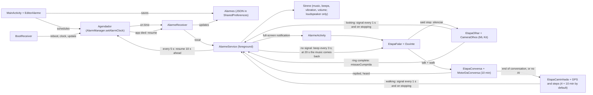

# Nightmare Alarm

An Android alarm clock app made to be impossible to ignore. It takes over the screen even with the phone locked and plays your music on loop at alarm volume, even in silent mode. To turn it off, you have to complete a mission: **say "STOP"** and then **look at the camera with your eyes open** for the time set in the app (20 + 20 minutes by default), until a ring is complete. Once it has rung, there is no other way out: no snoozing, no pausing, no turning the phone off (the power menu closes by itself, with the accessibility service on), no app crash.

There is also **"talk + walk"**: after STOP, a conversation in English with an AI (10 minutes by default) about the day's news, his plans and what it remembers of him from earlier mornings, time to get dressed and go out (4 minutes), and a walk outside (10 minutes), counted by GPS and by steps, rain or shine, with or without internet; all the times are adjustable in the app. The AI runs on the phone itself, without internet: Gemma 4 E2B (Google, Apache 2.0 license) through LiteRT-LM (`ModeloLocal`); it keeps notes about the person between mornings and can look a fact up on Wikipedia and in the news when asked. The model file (2.6 GB) is not in the APK: it is copied once over the cable into the app's folder on the phone; without it (or without the AI for any reason), this alarm goes straight to the walk. The two alarm types are very different on purpose: **"camera + phrases"** (camera, with phrases to repeat between the easy and the strict halves) and **"talk + walk"**. An internet engine (Gemini), ready to use, is parked outside the app in `reserva/gemini/` as plan B.

- **Stack:** Kotlin with Jetpack Compose (Material 3). Camera with CameraX; face and eyes with ML Kit, on the device itself.
- **Tested on:** Galaxy S24 FE (SM-S721B), Android 16 / One UI 8.5.
- **Language:** user interface, spoken lines and documentation in English; code identifiers, Kotlin file names, constants, the log tag, log messages and code comments in Brazilian Portuguese, by design.

## What the app does

| Feature | How it works | Where |
|---|---|---|
| Rings on the exact minute | `AlarmManager.setAlarmClock`, which ignores battery saving (Doze) | `Agendador.kt` |
| Takes over the screen, even when locked | A notification with `fullScreenIntent` opens an Activity with `showWhenLocked` and `turnScreenOn` | `AlarmeService.kt`, `AlarmeActivity.kt` |
| Two pages, dark | The main screen has two pages, swiped or tapped on the tabs: "Alarms" (just the alarms, with the "New alarm" button) and "More" (permissions, sounds, tests and settings, each a block that opens and closes). Dark "Noite" palette on these screens; the alarm screen keeps its own colors (red for the music, cream for the camera, blue for the walk) | `MainActivity.kt`, `Tema.kt` |
| Sound library, one sound per alarm | "Sounds" block on the "More" page: every sound added (system picker) is copied into the app's protected storage (`Sons`), so it keeps playing even if the original file leaves Downloads, and right after a reboot, before the first unlock. Each alarm picks its sound in the editor ("Sound": default, any library sound, or "Add new sound…"); the marked default plays for alarms without one; with no default, the phone's alarm ringtone. The medicine reminder keeps the app's gentle tone. The app ships no music. Over the cable, on the debug build: `adb push s.mp3 /data/local/tmp/ && adb shell run-as com.implacavel.alarme cp /data/local/tmp/s.mp3 /data/user_de/0/com.implacavel.alarme/app_sons/` | `Sons.kt`, `Cartoes.kt`, `EditorAlarme.kt`, `Sirene.kt` |
| Settings for the times and the volume | "Settings" block on the "More" page (`Tempos`, `Ajustes.tempos`): the alarm music volume as a two-handle slider (it starts at the first value and rises to the second in 30 s; 10% → 40% by default); "camera + phrases": easy camera 5–30 min (20), phrases to repeat 0–10 (5; 0 skips the verification), strict camera 5–30 min (20); "talk + walk": talk with the AI 5–30 min (10), time to get ready and go out 0–10 min (4), walking 5–30 min (10). The alarm cards and the editor show the current totals. The test buttons keep their own short times. Everything is frozen into the ringing alarm's snapshot (`EmAndamento.tempos`, read by the service and the alarm screen through `AlarmeService.temposDoAlarme`): changing a slider while an alarm rings does not shorten the mission in progress (that would be a way out). Tests keep their own short times and the default 10% → 40% music | `Tempos.kt`, `Ajustes.kt`, `Cartoes.kt` |
| AI companion: it remembers and looks things up | "AI companion" block on the "More" page: "About you" (free text the owner writes about himself, read by the AI every morning, `Ajustes.sobreMim`) and "What the AI remembers" (`Ajustes.memoriaDaIa`, with "Forget everything"). At the end of each conversation the AI writes its notes about the person from today's transcript only (`MotorDaConversa.anotar`, `pedidoDeAnotacoes`: up to 8 dated lines, `limparAnotacoes`), in a separate conversation while the walk starts; the notes replace the previous ones (nothing piles up) and expire after 36 h (`memoriaVale`, `Ajustes.memoriaDaIaValida`): a one-day window, because the recognizer and the small model get things wrong and a stack of wrong notes would turn into the AI nagging him about things it never understood. The next morning the "About you" text and the valid notes go into its instruction (told to mention the notes lightly and drop them if he says it was not like that) and, with notes, the opening follows up on one of them instead of the headline. During the conversation the AI can reply with a single line "SEARCH: <words>" (`consultaDaBusca`): the engine searches English Wikipedia (the first sentences of the 2 best articles) and Google News (3 recent headlines) in parallel for up to 4 s (`Pesquisa`), feeds the result back (`pedidoComResultado`) and only then answers; the screen shows "🔎 Looking up: …" and the voice says "Good question, sir. Let me check that."; at most 4 searches per conversation. The model itself stays on the phone | `Pesquisa.kt`, `ModeloLocal.kt`, `RegrasConversa.kt`, `Cartoes.kt` |
| Back · Cancel test · Next | On the alarm screen of a test alarm (only), after the good morning, three buttons at the bottom walk through the test's phases (`FaseDoTeste`): "talk + walk" = Talk › Wait › Walk; "camera + phrases" = Camera › Phrases › Camera 2 (strict; with 0 phrases set, Camera › Camera 2). Next ends the current phase (the talk ends, the deadline expires, the phrases start); Back returns (the walk goes back to the deadline with the waves; back to the talk reloads the model and opens a new conversation, with the talk clock reset, under its own 60 s deadline since the notes may still be being written). "Cancel test" needs a second tap within 4 s and ends the test without celebration. Real alarms never show them | `AlarmeActivity.kt`, `AlarmeService.kt`, `RegrasMissao.kt` |
| Blocks the power menu | An accessibility service (`VigiaDoDesligar`, turned on by the owner in Accessibility › Installed apps; the "Block the power menu" permission card leads there) watches for the power off / restart menu while an alarm rings (`ehMenuDeDesligar`: the system UI package plus the "GlobalActions" class or the "Power off" / "Restart" texts, in English or Portuguese) and closes it with Back (Home if it insists), like Alarmy. With no alarm ringing it ignores every event on its first line. A forced hardware reboot (holding the button for 7 s or more) cannot be stopped by any app; after it, the alarm comes back by itself | `VigiaDoDesligar.kt`, `Poderes.kt`, `RegrasMissao.kt` |
| Rings on silent and gets through Do Not Disturb | `MediaPlayer` and vibration with `USAGE_ALARM` | `Sirene.kt` |
| Mission, step 1: say STOP | The system speech recognizer in a loop; the music alternates 5 s loud and 4 s at 25% so the voice can be heard | `Ouvinte.kt`, `Missao.kt` |
| Spoken good morning | After STOP, the phone's voice (Android's speech synthesizer, in English, without internet) says "Good morning! It's 5:05 AM. It's time for the activity check." on the loudspeaker; 1.5 s later, "Activity starting now.", a positive beep (`positivo.wav`) and the camera starts. Every 10 full minutes of camera, "10 minutes passed." (and 20, 30). With no voice installed, only the pause and the beep. The voice plays at the volume chosen in the "Settings" block of the main screen (10% to 100%; 30% by default: `VOLUME_DA_VOZ`, `Ajustes.volumeDaVoz`, `volumeDaVoz`); the notice sounds (positive beep, chime, congratulations) at 40% (`volumeDosAvisos`), even while the volume ramp is still near its start | `Saudacao.kt`, `AlarmeService.kt` |
| Mid-session verification | At the end of the easy camera (20 min by default, set in the settings; 15 s in the test) the ring stops: a soft beep, "Let's verify that you are awake. Repeat the following sentences after me.", and the motivational phrases drawn for the day (`Frases.kt`; 5 by default, 0 to 10 in the settings: with 0, only the thanks and the stricter camera), which the voice says and the person repeats in English (`repetiu` accepts accents and contractions), with a "chime" for each correct one. While the person speaks, the screen shows what the recognizer hears ("Heard: …") and paints green the words of the phrase already said (`palavrasDitas`), with a blinking red cursor after the last correct one (where to continue from); a pause in the middle does not lose what was already said (`Ouvinte` with `juntar`, last 20 words). With no answer for 5 s, a loud whistle (another every 5 s); at 20 s the ring resets and the music comes back. Only speech with words counts as an answer, and for at most 30 s per phrase (`PRAZO_FRASE_MS`): a TV that is on or mumbling from bed cannot hold off the verification. At the end, "Thank you very much for your effort, sir. You reached the middle of the activity." and the camera continues, stricter about the eyes (average above 55%). Without English speech recognition, it is skipped | `AlarmeService.kt`, `Missao.kt`, `Frases.kt`, `RegrasMissao.kt` |
| Celebration at the end | Full ring: soft beep (`leve.wav`), "Congratulations, sir! The activity is done. Have a good time getting back to your activities." and a celebration burst (`comemoracao.wav`); the screen shows the congratulations and closes. The mission is already marked as done before the sounds: if the app crashes during the celebration, the alarm does not come back, and the previous volume stays saved (`Ajustes.volumeParaDevolver`) until it is restored. Another alarm that fires during the celebration rings right after it | `AlarmeService.kt`, `Missao.kt` |
| Mission, step 2: look at the camera | Front camera in a circle with a progress ring, which fills with open eyes in the time set in the settings (20 min easy + 20 min strict by default; 30 s with the test button). It only advances while the current frame shows open eyes; otherwise it stops immediately and never goes down. A frozen camera (no new frame for 1.5 s) counts as no face | `CameraOlhos.kt`, `Missao.kt`, `RegrasMissao.kt` |
| Visual camera feedback | Ring and text in green (looking) or red (eyes closed, no face), ML Kit's confidence that the eye is open and the minimum ("Eye open: 87% · minimum 40%"), the time left ("19:42 more with your eyes open") and the countdown to reset; a light screen at maximum brightness to light up the face | `Missao.kt`, `AlarmeActivity.kt` |
| YouTube during the camera step | Swiping right shows YouTube (m.youtube.com) full screen; the camera shrinks to a small bubble in the bottom-right corner, with the ring and, on top of it, the time left or the countdown to reset, like WhatsApp's video call bubble. The bubble can be dragged, and a tap on it (or Back) returns to the camera. Once the YouTube page has settled, sideways swiping is turned off (`userScrollEnabled`): the finger belongs only to the videos, otherwise a Short pulled up slightly crooked would switch pages. The mission keeps counting on YouTube; outside the camera step or off the screen, the video pauses | `PaginaYoutube.kt`, `Missao.kt` |
| No stalling | Stopped looking: at 3 s the screen shows "17 s to reset" and a very soft beep plays; every 3 s, another, louder, up to the phone's maximum volume at 18 s (in the test, very quiet: 2 of 15, without the strong sound), with a stronger sound. At 20 s, the music comes back and the mission restarts, with the ring reset (the watchdog lives in the service) | `AlarmeService.kt`, `Missao.kt`, `RegrasMissao.kt` |
| "talk + walk" alarm | Alarm type in the editor, separate from "camera + phrases" (in the editor, each one with its total time from the settings: "- 40 min" and "- 24 min" by default). STOP and good morning as always; with the phone AI ready, while the voice speaks, the app fetches the headlines (Google News), the goals (optional, `METAS_URL`) and the AI's first line. Then it decides the path (`CaminhoDaManha`): with the AI's opening, the conversation and then the walk; without the phone AI (`MotorDaConversa.disponivel`) or without its opening within 20 s, straight to the walk. Rain, internet and GPS change nothing: there is no camera in its place. Without internet, the conversation still happens (the AI is on the phone), only without the news. In the test ("Test talk + walk"): 3 min of conversation (+20 s), 30 s to go out (with the waves), 3 min walking, very quiet beeps (2 of 15, never the strong sound), and a test interrupted by a reboot does not come back | `AlarmeService.kt`, `RegrasConversa.kt` |
| The AI gets the recognizer's doubts | The speech recognizer (offline, always) returns up to 5 hypotheses; when the person's turn was a single sentence, the message to the AI carries the other hypotheses in parentheses ("The speech recognizer also heard: …", `falaComAlternativas`), and the instruction tells it to answer the version that makes sense without mentioning the recognizer. No extra AI call: the conversation keeps its pace | `Escuta.kt`, `RegrasConversa.kt` |
| Conversation with the AI | The AI speaks (the phone's voice reads it in English, at the voice volume) and the screen shows it; then it is "🎤 Your turn" and the screen shows "Heard: …". Each AI line has substance before the question: two short sentences, three at most (30 words, `RESPOSTA_MAX_TOKENS` 64; a line cut by the token cap loses only its unfinished sentence, `ateAUltimaFrase`) with a fact, an opinion, a tip or a reaction, usually ending in one open question; it answers what he asks (looking it up when unsure: see "it remembers and looks things up"), uses what it knows about him (his own text and its notes), stays on the topic while it is productive and only switches when it dies out (two short answers in a row). The conversation opens by following up on its notes about him or, without notes, by telling what the day's top headline is about (`pedidoDeAbertura`). The listening is done by `Escuta`: the app holds the microphone for the whole conversation, a noise detector (`DetectorDeSom`) checks every 20 ms, and the same sound goes to Google's recognizer through a pipe, in a single session (Android 13+). The turn passes to the AI 0.7 s after his last sound (1.6 s if the speech stopped on "and", "because", "um"…: `pausaPraPensar`), and it already starts thinking; if he makes any sound before its voice starts (an "uh", a "huh", a cough), the voice waits: with a new word, the reply is thrown away and the AI thinks again with everything he said; with only noise, the same reply plays at the next pause. Sound much quieter than his voice (15 dB, `somDaPessoa`) is from far away and does not count. While the app speaks or beeps, the microphone does not count (the echo of the voice is not him). The ring ("3:12 of 10:00 of talk") only advances while the AI's voice is playing, while he is making sound (less than 1.5 s ago) and during the first 3 seconds of his turn; while waiting for the AI or in silence, it stops. Silent on his turn: at 10 s a beep and another every 3 s, louder up to the maximum, endlessly (no reset and no music); speaking makes it stop. At the end of the talk time (10 min by default), the fixed question "Good talk, sir. Want to keep talking a little more?" (the answer waits for 1.6 s of silence): yes, 3 more min (only once); no, not understood or 10 s of silence, it ends. When what he said makes no sense (noise, Portuguese, a bad transcription), the instruction tells the AI to answer exactly "I did not get that, sir. Say it again, in English." instead of guessing (`naoEntendeu`); the service plays that fixed line, drops the turn from the notes and counts: on the 3rd in a row, a light-to-medium beep (`BIPE_DO_NAO_ENTENDI`, 2 of 6 steps) to wake him and the AI repeats its last real line, so the question comes back. The AI never shortens or ends anything; a line telling him to rest or saying the alarm is over becomes the fixed line "Not my call, sir. What is the first thing you will do today?" (`respostaSegura`). Three AI failures in a row, 20 s without its line (or speech recognition not working) end the conversation early; if the voice gets stuck recording the AI's line, the line goes on screen only within 10 s, and the turn passes to him | `AlarmeService.kt`, `Escuta.kt`, `Missao.kt`, `MotorDaConversa.kt`, `Noticias.kt`, `RegrasConversa.kt` |
| Walk by GPS and by steps | The walk stage is blue (the rest of the morning is cream, the music red). "Time to move, sir. Get dressed and go outside…" and a deadline to go out (4 min by default, set in the settings), with the sound of ocean waves (`ondas.ogg`, generated on the computer; a button under the countdown mutes them, 🔇, for that morning only: every morning starts with the waves on) (walking during it already counts, standing still does not beep). The GPS and the accelerometer belong to the service (`SentidosDaCaminhada`, `ContadorDaCaminhada`) and turn on right at STOP: during the conversation the GPS gets its fix, and when it is time to go out it is ready; the screen only draws. The ring ("7:12 of 10:00 walking") only advances when really walking on foot (outside, around the pool or back and forth, no need to run): the accelerometer feels steps at a walking rhythm (or, when it misses them, the GPS alone, up to 2 m/s); the GPS measures (by Doppler) a walking speed, 0.6 to 4 m/s, with the stride (speed ÷ steps) up to 1.4 m; and the GPS position moves along with that speed, in the same direction, over 12 s. Seconds not yet confirmed show as "checking" (light green) and are added all at once when the GPS confirms (up to 1 min of them). Each confirmed second also stores a second of trust (up to 90 s): under a roof (a covered corridor), where the GPS loses the speed, steps at a walking rhythm spend that trust and count right away ("Walking by your steps ✓"). Shaking the phone in bed does not count (the position never moves, and there is no trust without walking outside first), nor does a car or a bicycle (too fast, a long stride, or over 2 m/s with no steps); with GPS accuracy of up to 20 m and no fake location; stopped, it stops and never goes down. Two separate accounts: what counts (above) and what silences the beeps (any sign of life: steps, or GPS speed, even without counting; whoever shakes the phone is awake, and the alarm only turns off by walking). Below the ring, the trail seen from above, on a filtered path (a still position does not drift and a GPS jump does not show): green where it counted, light green while checking, gray where it did not. The GPS works without internet. After the deadline, with no sign of life: 20 s of peace, a weak beep at 23 s, then one every 3 s, a step louder each, up to the maximum with the strong sound at 41 s (`BIPES_PARADO_ATE_O_MAXIMO`), until moving again; at that first beep, once per morning, the voice and the screen offer a mini-task, repeating one motivational sentence (`MiniTarefa`, `ofereceMiniTarefa`; the recognizer only listens after the voice has finished saying it), which gives 3 more minutes of deadline with the waves back (30 s in the test): the owner sleeps so deep that the 4 min pass unnoticed; if he walks after that beep instead, the offer disappears for good; a beep bar on the screen shows where you are ("Stopped 12 s · beeps start in 11 s", "Beep 3 of 7 · maximum in 12 s", "🔊 Maximum · walk and it stops"), and the status line says why it is not counting (stopped, the GPS does not see you move, only on foot counts, too fast). In the test, beeps stay very quiet (2 of 15) and never use the strong sound. No plan B: indoors with no signal, with location turned off (TURN ON LOCATION button) or without its permission (ALLOW LOCATION button), the time does not advance and the beeps continue. Only on a phone with no GPS at all does the alarm turn off, as with a faulty camera | `Caminhada.kt`, `RegrasCaminhada.kt`, `AlarmeService.kt`, `AlarmeActivity.kt` |
| Phone loudspeaker only | Music, beeps and speech with `setPreferredDevice` set to the built-in loudspeaker (the `MediaPlayer` for sounds and the `AudioTrack` for speech): with headphones or Bluetooth connected, the alarm does not go to them (Android 9+) | `Sirene.kt` |
| Closing the screen does not help; after STOP, talk + walk goes on in the background | Home, swiping the app away or turning the screen off while the music plays, during the good morning or in the camera step: within 1 s the music comes back and a new full-screen notification reopens the alarm (on the Galaxy S24 FE, 1.3 to 3.6 s in total); in the camera step, the ring stays where it was. In "talk + walk", after the good morning, the conversation and the walk live in the service (the microphone, the AI voice, the GPS and the steps, with the foreground service types `location` and `microphone` granted at STOP while the screen is in front): closing the screen changes nothing, he can use another app or keep the phone in the pocket, the beeps still come, and the notification shows where the morning is ("Walking · 2:05 of 10:00 · tap to come back"), updated every 5 s; tapping it brings the screen back | `AlarmeActivity.kt`, `AlarmeService.kt` |
| The app crashing does not help | While it rings, the service keeps a resume in AlarmManager (which runs outside the app) always 10 s ahead. If the app crashes, freezes or is killed, or the phone turns off, Android restarts the alarm by itself (a test does not come back: it just ends), and after STOP the mission continues from where it was: every 5 s the service saves the camera ring, the morning stage, the conversation time, the walked time and the deadline (`Progresso`, `Ajustes.progresso`). The conversation with the AI does not come back (it may have been the cause): it goes to the walk. Emergency exit over the cable only: `adb shell am broadcast -n com.implacavel.alarme/.PararPeloCabo` | `AlarmeService.kt`, `Agendador.kt`, `App.kt` |
| Turning the phone off does not help | The alarm in progress stays saved until it is completed; when the process comes back (phone turned on again, app reopened), it rings again within a few seconds | `Ajustes.kt`, `App.kt` |
| No way out | No snooze, pause or nap. The alarm that rang becomes a saved "snapshot", with the music and the volume: editing, disabling or deleting the alarm, changing the music or lowering the volume midway changes nothing. Revoking the camera permission shows "ALLOW CAMERA", not "TURN OFF". Two alarms at the same time become one, with the stricter requirement; a real alarm in the middle of the test takes its place, with its own rules (the full times) | `AlarmeReceiver.kt`, `AlarmeService.kt`, `Alarme.kt`, `Missao.kt` |
| Volume ramping up and locked | Every alarm starts at the first value of the "Music volume" setting and rises to the second in 30 s (10% → 40% by default, `SUBIDA_ALARME`; `EmAndamento.volumeAgora`; the test alarms always use the default, so a test at home never gets loud; the medicine reminder, below, ramps differently), exactly, even with the phone set louder: it is music, to be heard for a bit before waking up. While the music, a spoken line or a notice sound plays, every 1 s it undoes any attempt to lower it (down to that sound's own volume: the voice stays at the chosen one, 30% by default); with everything quiet (the camera, YouTube), the volume and the side buttons belong to the person; the previous volume comes back at the end. Only the beeps go above it, while they play. After the app crashes, the volume goes back to the ramp's point | `Sirene.kt`, `Alarme.kt` |
| Medicine reminder | Each alarm is of a single type, chosen in the editor: "camera + phrases" (music, STOP and camera), "talk + walk", or medicine reminder (a gentle tone from the app, `lembrete.wav`, from 15% to 75% of the volume in 2 min, `SUBIDA_REMEDIO`, and a TURN OFF button) | `Alarme.kt`, `Sirene.kt`, `EditorAlarme.kt` |
| Pauses music and video from other apps | Audio focus `AUDIOFOCUS_GAIN_TRANSIENT` from firing until the mission is complete, including the 40 min of camera | `Sirene.kt` |
| AI speech at the right volume from the first word | On the S24 FE, `MediaPlayer` plays every sound of 5 s or longer starting very quiet and rising over about 3 s (measured on the output to the loudspeaker, `dumpsys media.audio_flinger`, "Signal power history": a 6 s tone came out 20 dB lower in the 1st second; sounds of 4.5 s or less did not). The AI's lines are longer than 5 s, the verification phrases are not: that is why only the AI (and sometimes the good morning) "started quiet and kept getting louder". Every spoken line now plays through `AudioTrack`, all at once (`faixaDaFala`), without that ramp: measured equal from the first to the last second. The app's short sounds and the music stay on `MediaPlayer`. Also, after 2 s without sound the loudspeaker output goes to sleep (a 2 s "Standby delay"), and the first half second after it wakes up comes out about 3 dB louder: in "talk + walk", from STOP to the end of the conversation, a near-silence on loop (`silencio.wav`, noise at -84 dB, inaudible) keeps it awake (`Sirene.manterAcordado`); in "camera + phrases", the 10-minute notices wake it 1.5 s before speaking (`falarDepoisDeAcordar`) | `Sirene.kt`, `Wav.kt`, `AlarmeService.kt` |
| Notification that does not go away | `setDeleteIntent` shows the notification again if the user swipes it away (Android 14+) | `AlarmeService.kt` |
| Volume buttons do not silence it | `onKeyDown` consumes volume-down and mute | `AlarmeActivity.kt` |
| Survives a reboot | Reschedules on boot, including before the 1st unlock (direct boot), and every time the app is opened (not when the screen rotates) | `BootReceiver.kt`, `MainActivity.kt`, `Alarmes.kt` |
| Repeat by day of the week | `dias` uses `DayOfWeek.value` (1 = Mon … 7 = Sun) | `Alarme.kt` |
| Permissions checklist | A "Permissions" block that opens and closes (`SecaoRecolhivel`): closed, "✓ All allowed" or how many are missing; open, all of them (location too), each with ✓ or "Allow", which asks in the system dialog or opens the right Settings screen. If any is missing, it appears open and in red. The test buttons are in another collapsed block, "Tests": "Test camera + phrases" and "Test talk + walk", with how long each stage lasts in the test and the state of the phone AI | `Poderes.kt`, `Cartoes.kt` |
| Voice volume | A "Settings" block that opens and closes, with the app's voice volume on a slider (10% to 100%, in steps of 5, with the percentage on screen; 30% by default). The phone's alarm volume has only 15 steps: the voice goes to the step just above and plays slightly quieter within it, using the dB math between the two steps (`ganhoEntreDegraus`, with the dB values Android reports for the loudspeaker), so that each position sounds different. It applies from the next spoken line on; the music, the beeps and the notices do not change. After a fresh install, it goes back to 30% (installing over the existing app keeps it) | `Cartoes.kt`, `Ajustes.kt`, `Sirene.kt` |

## How to build and install

Requirements:

- JDK 17 or newer.
- Android SDK with `platforms;android-37.0` and `platform-tools`.
- ARM phone with USB debugging turned on.

```bash
./gradlew testDebugUnitTest   # tests for the schedule rules, texts and mission
./gradlew assembleRelease     # builds app/build/outputs/apk/release/app-release.apk (~20 MB)
./gradlew lintDebug           # must finish with 0 errors
./install.sh                  # builds, installs and opens the app on the phone connected through adb
adb logcat -s Implacavel      # follows an alarm: firing, sound, what the voice heard, what the camera sees
```

- **The phone AI model** (for "talk + walk"): download `gemma-4-E2B-it.litertlm` (2,588,147,712 bytes, SHA-256 `181938105e0eefd105961417e8da75903eacda102c4fce9ce90f50b97139a63c`) from huggingface.co/litert-community/gemma-4-E2B-it-litert-lm and, with the app already installed and opened once, copy it **directly** into the app's folder (no subfolder: a folder created over the cable belongs to adb and the app cannot get into it): `adb push gemma-4-E2B-it.litertlm /sdcard/Android/data/com.implacavel.alarme/files/`. Uninstalling the app deletes the model with it: afterwards, repeat the `adb push` (installing over the existing app, with `install -r`, keeps it). While an alarm rings, the app's log also goes to `diagnostico.log` in the app's folder, plus the older `.1` to `.4` (1 MB each; it survives a phone reboot): `adb pull /sdcard/Android/data/com.implacavel.alarme/files/ diagnostico` brings the whole folder (with the 2.6 GB model along; for just the log: `adb shell ls /sdcard/Android/data/com.implacavel.alarme/files/` and one `adb pull` per `diagnostico.log*` file). Test without sound: `adb shell am broadcast -n com.implacavel.alarme/.TesteDaIa` and `adb logcat -s Implacavel` (the replies of a fake conversation, load time, reply time, speed, memory and heat); with `--ei tokens 6144`, it compares another conversation size without recompiling. Sound tests, also over the cable: `adb shell am start -n com.implacavel.alarme/.TesteDoSom` (the `MediaPlayer` ramp versus `AudioTrack`, very quietly; then `adb shell dumpsys media.audio_flinger`), `--ez cano true` (the recognizer through the pipe, no sound) and `--ez escuta true` (the conversation's ear on the microphone for 20 s). Walk test, without sound: `adb shell am start -n com.implacavel.alarme/.TesteDoGps` (15 min; `--ei minutos N`); you can unplug the cable and walk, and then `adb pull /sdcard/Android/data/com.implacavel.alarme/files/teste_gps.log`.
- Optional, in the root `local.properties` (outside git), read by `app/build.gradle.kts` into `BuildConfig`: `METAS_URL=https://...` (a page with the owner's goals, in plain text or simple HTML, which the AI uses in the conversation). No AI key goes into the app. The Gemini parked in `reserva/gemini/` used `GEMINI_API_KEY` (the `README.md` there explains how to turn it back on).
- The release APK is signed with the debug key (`~/.android/debug.keystore`). That is enough for personal use. To install over an existing install, the same key is required; without it, uninstall first.
- In Brazil, from 2026-09-30, an APK installed from a file on a certified phone must come from a verified developer. Installing via `adb` (`install.sh`) is still allowed.

## Architecture

Flow of an alarm, from creation to turning it off:



Shared state, with no ViewModel, dependency injection or database. Everything runs on the main thread, except the analysis of camera frames, the internet fetches of "talk + walk" (news and goals) and the AI engine, which deliver their results on the main thread:

- `Alarmes.lista` (`StateFlow<List<Alarme>>`) is the saved list. The screen observes it; receivers and the service read and write it.
- `Ajustes.musica` (`StateFlow<Musica?>`) is the chosen music (URI + name).
- `AlarmeService.tocando` (`StateFlow<Alarme?>`) is the alarm active right now. `AlarmeActivity` closes itself when it becomes `null`.
- `AlarmeService.silenciado` (`StateFlow<Boolean>`) says whether the person has already said "stop" (music silenced). The screen derives the stage from it: `false` = SPEAK, `true` = LOOK.
- `AlarmeService.ultimoOlhar` (`StateFlow<Long>`, `SystemClock.elapsedRealtime`) is when the last "looking" signal (or the "stop") arrived. The watchdog counts the beeps and the 20 s from it, and the screen counts the countdown to reset from it: a single clock.
- `AlarmeService.olhado` (`StateFlow<Long>`) is the open-eyes time already added to the ring in this camera round, which the screen sends along with each "looking" signal. It only resets after 20 s without looking (and at the end of the alarm): leaving the screen brings the music back, but after STOP the camera continues from here, and so does a screen recreated midway.
- `Ajustes.emAndamento` (`EmAndamento?`, saved as JSON) is the snapshot of the alarm that rang and has not been completed yet: the alarm, when it rang, the music and the previous volume. Only `AlarmeService.concluir` deletes it.
- `AlarmeService.comCaminhada` (`StateFlow<Boolean>`) says whether the current morning is a "talk + walk" one (the good morning shows "Preparing the morning…"; the 40-min mission, "The camera starts soon").
- `AlarmeService.conversa` (`StateFlow<Conversa?>`) is the conversation with the AI in progress: the AI's line, whether it is the person's turn, whether it is thinking, the conversation time and the target, and whether it is the "keep going?" question. `AlarmeService.ultimaFala` is when the turn started or when the person last spoke (silence counts from here).
- `AlarmeService.caminhada` (`StateFlow<Caminhada?>`) is the walk in progress: the saved walked time, the target and the end of the deadline to go out (`prazoAte`, absolute). `AlarmeService.ultimoPasso` is the last "walking" signal (the watchdog and the countdown to the beep count from here).

Lifecycle of a firing:

1. `Agendador.agendar` creates a DISPARAR (fire) broadcast `PendingIntent` per alarm (request code `id * 2`) and schedules it with `setAlarmClock`.
2. `AlarmeReceiver` receives it and updates the saved alarm:
   - alarm disabled (stale schedule): ignores it;
   - one-time alarm: `ativo = false`;
   - repeating alarm: schedules the next repetition.

   Then it saves the snapshot in `Ajustes.emAndamento` (if there was already one, it merges the two with `EmAndamento.juntar`), arms the resume and calls `AlarmeService.tocar`. Snapshot and resume come before the service: if the app crashes from here on, the alarm comes back.
3. `AlarmeService` reads the snapshot, becomes a foreground service (`specialUse`), shows the notification, starts the `Sirene` with the snapshot's music and the volume at the ramp's point (`EmAndamento.volumeAgora`) and starts pushing the resume forward every 5 s.
4. With the screen off or locked, the system opens `AlarmeActivity`. With the phone in use, the notification appears (on Samsung, first the edge lighting, then the full screen).
5. With `missao = true`, the screen runs the mission (right after the phone reboots, before the first unlock, the **UNLOCK** stage comes first: Google's voice only runs after unlocking, so the button opens the PIN pad over the alarm):
   - **SPEAK:** `EtapaFalar` alternates the music volume via `AlarmeService.volume` and listens with `Ouvinte`. On hearing "stop", it calls `AlarmeService.silenciar`: the music stops, `silenciado` becomes `true` and the service's watchdog starts counting. If there was already looked time (the person left the screen in the middle of the camera), it shows "Ring saved: 15:42 left".
   - **GREETING:** with `silenciado` and `saudando` both `true`, `EtapaSaudacao` shows the good morning while the service records the speech (`Voz`, `synthesizeToFile`) and plays it through the `Sirene` (loudspeaker, alarm volume). 1.5 s after it ends, it plays the fixed line "Activity starting now." (recorded when the voice becomes ready) and the positive beep; then `saudando` becomes `false`, the watchdog starts and the screen moves on to the camera (or after 20 s, if the voice gets stuck). The music coming back midway cancels the greeting.
   - **LOOK:** `EtapaOlhar` opens `CameraOlhos` and fills the ring until it adds up to `metaOlhar` (the settings' time, 40 min by default; 30 s in the test) of open eyes, in real time. While the person looks, it calls `AlarmeService.olhando` every second, and once at the instant they stop; each signal resets the watchdog's count. After 3 s without looking, the screen shows "N s to reset", counted from `AlarmeService.ultimoOlhar`. A full ring calls `AlarmeService.missaoCumprida`.
   - **Watchdog:** every 3 s without a signal, a beep louder than the previous one (`Sirene.bipe`, `volumeDoBipe`: while it plays, each beep sets the phone's alarm volume to its own step, from 1/6 of the maximum to the maximum; on the S24 FE, 3, 5, 8, 10, 13 and 15 out of 15; in the test, they stop at 6, the notice volume; afterwards, the volume goes back to the previous one). The last one plays `bipe_final.wav`. At 20 s without a signal, it resets the ring (`AlarmeService.olhado`) and turns the music and the notification back on; `silenciado` goes back to `false` and the screen, if it is open, goes back to SPEAK.

   - **"talk + walk" alarm** (`caminhada = true`): at STOP, `prepararManha` fetches (if `MotorDaConversa.disponivel`) the news and the goals (`Noticias.buscar`), creates the engine (`MotorDaConversa.criar`) and asks for the opening; without the AI, it fetches nothing. At the end of the good morning, instead of "Activity starting now", `saudacaoFeita` → `decidir`, waiting up to 20 s for the opening with the screen on the good morning: with it, `CONVERSA_E_CAMINHADA`; without it, `SO_CAMINHADA` (straight to `irPraCaminhada`). **TALK:** the AI's line is recorded (`Voz.gravar`) and played; when it ends, `suaVez`. `Escuta` (created in `abrirConversa`, released in `pararEscuta`) reports each sound (`somNaConversa`) and the text of the turn (`textoNaConversa`); `pausaPraPensar` after the last sound, `fimDaVez` sends the text to the AI and keeps the `Provisoria`: a sound from him before the voice holds it back, a new word throws it away (`descartarResposta`, with `MotorDaConversa.descartar` or `cancelar`), and only noise lets it out at the next pause (`tocarFalaDaIa`); while the voice or a beep plays, `falarNaConversa` and `surdoPor` make the listener deaf; `tiqueDaConversa` (250 ms) adds time via `conversaAnda` and plays the silence beeps. Target reached: `FALA_CONTINUAR` and `querContinuar`. At the end, `irPraCaminhada` (`FALA_SAIR`; it cancels a good morning that is still being recorded, and the walk starts within 20 s even if the line gets stuck). **WALK:** the `SentidosDaCaminhada` (on since STOP, on the alarm screen) pass each GPS fix and the accelerometer to `DetectorDeCaminhada`; `EtapaCaminhada` adds up what it says and sends `andando` every second while walking and on stopping; `vigiaDaCaminhada` beeps when stopped after the deadline. The music coming back midway (`religarMusica` → `pausarManha`) keeps the path, the stage, the conversation (with the history in the AI), the walked time and the deadline; after STOP and the good morning, the morning continues from where it was (`continuarManha`; the AI resumes with `MotorDaConversa.retomar`).

   With `missao = false`, only the TURN OFF button appears (`AlarmeService.desligar`, which the service only accepts for an alarm without a mission).
6. While the alarm lasts, `AlarmeActivity` notifies the service in `onStart`/`onStop` (`AlarmeService.tela`). If the screen disappears for 1 s, the service turns the music back on and posts a second full-screen notification (`Notificacoes.ID_CHAMADA`), which reopens the screen, even with the phone locked. The camera ring does not reset because of this: after STOP, it continues from where it stopped.
7. Mission complete (`missaoCumprida` or `desligar` → `concluir`) is the only end (apart from the emergency exit over the cable, `PararPeloCabo`): it restores the previous volume, deletes the snapshot and the progress and cancels the resume; the cleanup happens in `onDestroy`. If the process dies before that (crash, freeze, "Force stop", phone turned off), the resume fires, or `App.onCreate` arms a new one when the process comes back, and `AlarmeReceiver` sets the snapshot ringing again.

## File map

Code in `app/src/main/java/com/implacavel/alarme/`. Each file starts with a comment saying what it does.

| File | Responsibility |
|---|---|
| `App.kt` | Process start: loads alarms and settings, creates the notification channel and restarts an interrupted alarm. Also has `TAG` (logs) and `prefsProtegidas` (storage readable before the 1st unlock) |
| `Alarme.kt` | Model and the rule for when it rings (`proximoDisparo`), `nome` for display, `deTeste` (the alarms of the two test buttons), `caminhada` (the "talk + walk"), `som` (the alarm's sound in the library), `normalizado` (a single type) and the JSON; and `EmAndamento`, the snapshot of the ringing alarm, with `juntar` (two alarms become one), the settings frozen at ring time (`tempos`; the volume ramp `subida` comes from them, except for tests and the medicine reminder) and `volumeAgora` |
| `Alarmes.kt` | Repository: in-memory list + saving to device-protected storage |
| `Ajustes.kt` | Voice volume (`volumeDaVoz`, `VOLUME_DA_VOZ` by default), the times and the music volume (`tempos`, a `Tempos`), the muted waves (`ondasMudas`), what the owner wrote about himself (`sobreMim`) and the AI's notes about him from the last talk (`memoriaDaIa`, `memoriaEm`, `memoriaDaIaValida`), the snapshot of the alarm in progress (`emAndamento`) and where its mission is (`progresso`, a `Progresso` from `Alarme.kt`) |
| `Sons.kt` | The sound library: copies into device-protected storage (`app_sons/`), the default sound, `uriDoAlarme` (the alarm's sound, else the default, else null = phone ringtone), migration of the old single music URI; pure helpers `nomeSeguro` and `nomeLivre` |
| `Agendador.kt` | AlarmManager: `agendar` (next occurrence), `agendarTeste`, `agendarRetomada`/`cancelarRetomada` (safety net for the alarm in progress), reschedule everything |
| `AlarmeReceiver.kt` | Receives DISPARAR (fire: updates the saved alarm, saves the snapshot, arms the resume and calls the service) and RETOMAR (resume: sets the alarm in progress ringing again) |
| `BootReceiver.kt` | Reschedules after a reboot, a clock/time zone change or an app update |
| `AlarmeService.kt` | Foreground service: notification, commands (`tocar`, `missaoCumprida`, `desligar`, `reexibir`, `tela`, `silenciar`, `olhando`, `volume`, `darTempo`, `ouviu`, `repetiu`, `semVoz…`, `respondeu`, `ondas`, `miniTarefaFeita`, `irPraFase`, `cancelarTeste`), mission watchdog, mid-session verification, screen reopening, resume renewal, defect valve and `concluir`, the only end of the alarm. In "talk + walk", the path decision and the morning stages: conversation (clock, silence beeps, a line that arrives in pieces, the keep-going question, fixed lines, AI failures) and walk (stopped watchdog, deadline to go out, the waves); the AI's notes at the end of the conversation; the test phase jumps (`irPraFase`, `voltarPraConversa`) |
| `Sirene.kt` | Music on loop, warning beeps, vibration, audio focus, loudspeaker kept awake (`manterAcordado`), the waves of the deadline to go out (`ondas`), relative volume and volume lock from start to end (`preparar`, `tocar`, `calar`, `bipe`, `desligar`); speech through `AudioTrack` (`falar`), everything else through `MediaPlayer`; every sound comes out of the phone's loudspeaker |
| `Notificacoes.kt` | The "Alarm ringing" channel (silent on purpose; the sound comes from the `Sirene`) |
| `Poderes.kt` | `enum Poder`: each required permission knows whether it is `liberado` (granted), which dialog permission is missing and how to open the right Settings screen |
| `AlarmeActivity.kt` | Alarm screen: clock, mission stage (or TURN OFF), maximum brightness from start to end, system bar icons matching the background, screen open/closed notice to the service, and whether the phone has been unlocked since it was turned on |
| `Missao.kt` | Stages UNLOCK (`EtapaDesbloquear`; only right after a reboot), SPEAK (`EtapaFalar`), GREETING (`EtapaSaudacao`), VERIFICATION (`EtapaVerificacao`), TALK (`EtapaConversa`: the AI's line, "🎤 Your turn", "Heard: …", the conversation time ring and the countdown to the beep) and LOOK (`EtapaOlhar`), progress ring, time left, countdown to reset, feedback texts, the camera request when the permission was revoked (unlock, dialog or Settings with grace time) and `AvisoComBotao`, the notice with a big button used by the exits and requests; the camera and YouTube pages and the camera that turns into a bubble (`CameraMovel`) |
| `Ouvinte.kt` | Continuous speech recognition until it hears what is asked for (the "stop", or the verification phrase, in English); gives up (and the screen shows the button, or the verification is skipped) after 5 errors in a row, without the language, or after 8 s without a signal from the recognizer |
| `Escuta.kt` | The ear of the conversation with the AI (Android 13+): the app's microphone in 20 ms chunks, the noise detector on each one (`onSom`, with the volume) and the same sound to Google's recognizer through a pipe (`EXTRA_AUDIO_SOURCE`), in a single session that does not close between sentences (`onTexto`); deaf while the app speaks or beeps (`surdo`, `surdoPor`); opens another session if the current one drops or goes 6 s with sound but without writing anything |
| `Wav.kt` | 16-bit PCM WAV: `lerPcm16` (the synthesizer's speech), `faixaDaFala` (the whole line in one `AudioTrack`) and `gravarWav` (the loudspeaker test) |
| `Frases.kt` | The motivational phrases of the mid-session verification and `frasesDoDia` (as many as the settings say, 5 by default, drawn per day) |
| `Saudacao.kt` | `saudacao` and `textoDaSaudacao` (pure), the fixed lines (also those of the conversation and the walk: `FALA_CONTINUAR`, `FALA_SAIR`, `FALA_NAO_NEGOCIA`) and `Voz`, the speech synthesizer that records the lines to files, with a voice installed on the phone (`vozSemInternet`: the internet one depends on the signal) and each recording's time in the log |
| `MotorDaConversa.kt` | The "plug" for the conversation AI (`abrir`, `responder`, `retomar`, `cancelar`, `desligar`, `anotar`, `aoProcurar`; `disponivel`, `preparar`, `criar`, `liberar`) and `Turno`. Today it plugs into `ModeloLocal`. The internet Gemini, ready and tested, is parked in `reserva/gemini/` (outside the app) |
| `ModeloLocal.kt` | The on-phone AI: Gemma 4 E2B through LiteRT-LM (`com.google.ai.edge.litertlm`, 0.16.1, the last one with Kotlin 2.2), on the CPU, on a single thread. It loads when the alarm rings (`preparar`, ~6.5 s), creates the conversation with the coach instruction (sampling top-k 64, top-p 0.95, temperature 0.9, 64 tokens per line) and keeps the history in the model itself; `trocar` is one exchange (if the AI asks for a search, `Pesquisa` runs and the result goes back before the final line); `anotarCom` writes the notes in a separate conversation with a bigger token cap; it leaves memory at the end of the conversation (`liberar`, after the notes). Available only with the complete file (`TAMANHO_DO_MODELO`), 64-bit and 1.5 GB free to load with headroom (once loaded, the app uses ~520 MB); while loading, it counts as available (its own memory does not count against it). With the cable test running (`emTeste`), an alarm does not load another one |
| `PararPeloCabo.kt` | Emergency exit over the cable only (receiver protected by the `DUMP` permission, which only adb has, and which works before the first unlock): ends the alarm in progress without a celebration, or, with the service stopped, deletes the snapshot, the progress and the resume and restores the volume |
| `TesteDaIa.kt` | AI test without sound or screen, over the cable only (receiver protected by the `DUMP` permission, which only adb has): loads the model, holds a fake 5-line conversation with notes from an earlier morning (the opening that follows them up, one on topic, a fact question that should trigger "SEARCH:", a short one and the request to sleep), then writes the notes as at the end of a morning, and logs the replies, the searches, the times, the speed, the memory and the heat; `--ei tokens N` tests another conversation size; `--ez cancelar true` shows that stopping the model midway (`cancelProcess`) breaks the conversation |
| `TesteDoSom.kt` | Sound tests over the cable only (screen protected by `DUMP`): the ramp (a 6 s tone through `MediaPlayer` and through `AudioTrack`, at minimum volume; the measurement shows up in `dumpsys media.audio_flinger`), `--ez cano true` (the recognizer hearing a recorded line through the pipe, no sound) and `--ez escuta true` (`Escuta` on the microphone for 20 s: the sounds and the text length in the log) |
| `TesteDaEscuta.kt` | Speech recognition test with the person's own voice, over the cable only (`DUMP`), no sound: 10 English sentences to read aloud, each recorded to `files/escuta/frase_NN.wav` and then fed through the pipe to each offline recognizer on the phone (Google Speech Services en-US, Android System Intelligence en-GB) with 5 hypotheses; word error rate (`taxaDeErro`), best-of-5 and latency in `resultado.txt`, on screen and in the log (only here the heard text is logged). `TesteDoSom --ez cano true --es servico as --es idioma en-GB` feeds a synthesized sentence to a chosen recognizer; `--ez suporte true` lists each recognizer's languages |
| `TesteDoGps.kt` | Walk test over the cable only (screen protected by `DUMP`), with no alarm and no sound: the real walk screen, with no deadline and no beep, with each fix, the satellites and the accelerometer in the log and in a file (`teste_gps.log`, to walk without the cable) |
| `Noticias.kt` | Google News headlines (RSS, up to 5, `MANCHETES_MAX`) and the goals from `METAS_URL`, fetched in parallel on a background thread; `manchetesDoRss`, `textoDoXml`, `textoDasMetas` (pure) and `baixarTexto` (GET with a 5 s timeout) |
| `RegrasConversa.kt` | Pure conversation rules: `CaminhoDaManha`, `metaConversa`, `conversaAnda`, `avancarConversa`, `bipesDoSilencio`, `DetectorDeSom`, `pausaPraPensar`, `somDaPessoa`, `nivelDaVoz`, `quantasPalavras`, `querContinuar`, `respostaSegura`, `limparFala`, `ateAUltimaFrase`, `consultaDaBusca`, `pedidoComResultado`, `pedidoDeAnotacoes`, `limparAnotacoes`, `memoriaVale`, `pedidoDeAbertura`, `pedidoDeContinuar`, `pedidoDepoisDeInterrompida`, `instrucaoDoTreinador` and the times |
| `Caminhada.kt` | `SentidosDaCaminhada` (the GPS at 1 fix/s, the satellites and the accelerometer: `ligar`/`desligar`, owned by the service since STOP; `rememberSentidosDaCaminhada` only for the GPS test), `ContadorDaCaminhada` (the 250 ms walk clock: sums, gives the sign of life, concludes) and `EtapaCaminhada` (display only): the "7:12 of 16:00 walking" ring (with what is being checked, lighter), status (walking, checking, stopped and why, weak GPS, fake location), the trail (`Trilha`, the filtered path), deadline to go out, countdown to the beep and the TURN ON LOCATION and ALLOW LOCATION buttons (`PedirLocalizacao`); `gpsLigado`; the 30 s summary in the log |
| `RegrasCaminhada.kt` | Pure walk rules: `DetectorDePassos` (steps from the accelerometer), `Trilho` (the filtered path, for drawing), `andou` (the GPS position moved along with the speed), `DetectorDeCaminhada` (the decision for each fix, with the reason, what is added and what is being checked), `distanciaM`, `emMetros`, `primeiroBipeParado`, `segundosProBipe`, `avisoDoPrazo`, the times and the limits |
| `CameraOlhos.kt` | Front camera (CameraX, 15 frames/s) + face detection (ML Kit) → a `Leitura` every 500 ms; faulty camera → `SEM_CAMERA` |
| `PaginaYoutube.kt` | `YoutubeDaMissao` (the WebView: created when the page opens, paused outside the stage and off the screen, proof against the page crashing and against links leading out) and `PaginaYoutube` |
| `RegrasMissao.kt` | Pure mission rules: `disseStop`, `classificarRosto`, `metaOlhar`, `verificacaoEm`, `marcoCompletado`, `avancarOlhar`, `segundosParaZerar`, `volumeDoBipe`, `linkFicaNaPagina`, the test phases (`FaseDoTeste`, `faseDoTeste`), `ehMenuDeDesligar` and the times |
| `Tempos.kt` | The adjustable times and the music volume (`Tempos`, `TEMPOS_PADRAO`, the ranges, `ajustado`, `minutos`) |
| `VigiaDoDesligar.kt` | Accessibility service that closes the power menu while an alarm rings (`ligado` checks whether the owner turned it on); config in `res/xml/vigia_do_desligar.xml` |
| `Pesquisa.kt` | The search the AI can ask for: English Wikipedia (the API, the first sentences of the 2 best articles, with a User-Agent) and Google News RSS search, in parallel, up to 4 s (`Pesquisa.buscar`); `trechosDaWikipedia`, `resultadoDaBusca` and the URLs are pure |
| `MainActivity.kt` | Main screen in two pages (`HorizontalPager` + `TabRow`): "Alarms" (header and the list, with the "New alarm" button) and "More" (permissions, sounds, tests, settings, AI companion); state, permission requests, sound picker. Reschedules everything when opened |
| `Cartoes.kt` | Header, the blocks that open and close (`SecaoRecolhivel`: permissions, sounds in `SecaoSons`, tests, settings in `SecaoAjustes` (voice volume, the music volume range and the times) and the AI in `SecaoIa` (about you, what it remembers)) and each alarm's card |
| `EditorAlarme.kt` | Dialog to create and edit an alarm |
| `Formatacao.kt` | Texts for the time, the days and the time left on the ring (pure functions) |
| `Tema.kt` | Always-light theme (no dark version: the YouTube of the camera step also opens light), fixed alarm screen colors (`VermelhoAlarme`, `VinhoAlarme`), the `agoraACada` clock and `lidoAoVoltar` (rereads permissions when the screen comes back from the dialog or from Settings) |

Other files:

- `app/src/main/AndroidManifest.xml`: permissions, `queries` for speech recognition and the speech synthesizer, and components. Those on the alarm path have `directBootAware`.
- `app/proguard-rules.pro`: keeps ML Kit intact during R8 optimization (see the design decisions).
- `app/src/main/res/raw/alarme_reserva.wav`: beeps used if neither the music nor the system ringtone can be read (e.g. before the first unlock).
- `app/src/main/res/raw/bipe.wav`: the "bee-beep" warning of the camera step (2 kHz, 0.32 s), synthesized for the app.
- `app/src/main/res/raw/bipe_final.wav`: the 6th beep, at 18 s (3 pulses of 0.25 s at 3 kHz, nearly square, 0.87 s), synthesized for the app. Already at the phone's maximum volume, the beep can only get louder through the sound itself: more energy at the same peak, higher pitched (where the ear is more sensitive) and longer; the owner found the 6th beep too quiet with the `bipe.wav` sound.
- `app/src/main/res/raw/lembrete.wav`: the medicine reminder tone (soft C, E and G, like a glass bell, 2.6 s on loop), synthesized for the app.
- `app/src/main/res/raw/acerto.wav`: the "plim" when a verification phrase is repeated correctly (`Sirene.acerto`).
- `app/src/main/res/raw/ondas.ogg`: the sea waves during the deadline to go out on the walk, generated on the computer.
- `app/src/main/res/raw/silencio.wav`: an inaudible near-silence (noise at -84 dB) played on loop from STOP to the end of the talk, so the speaker output does not fall asleep (`Sirene.manterAcordado`).
- `app/src/main/res/raw/positivo.wav`, `leve.wav` and `comemoracao.wav`: the "you can start" beep (E and A), the soft ding before the congratulations and the sparkly burst at the end, synthesized for the app.
- `app/src/test/java/com/implacavel/alarme/`: `AlarmeTest` (times, name, JSON, types and alarm in progress), `FormatacaoTest` (texts and time left), `MissaoTest` (voice, face, ring, countdown to reset and beeps), `ConversaTest` (conversation rules, news and goals) and `CaminhadaTest` (steps, the rule on a fake person, three real recorded walks in `src/test/resources/` (without coordinates), distance, times, the stopped beep and the walk texts).
- `install.sh`: builds, installs and opens the app on the phone via `adb`.

## Design decisions (read before changing)

- **`setAlarmClock` and not `setExact`.** It is the only kind of scheduling that Android treats as an alarm clock. It ignores Doze, allows starting a service from the background and shows the alarm icon in the status bar. The `USE_EXACT_ALARM` permission is granted at install time; the Play Store only accepts it in alarm clock apps, but this app does not depend on Play.
- **Sound in the `Sirene`, not in the notification channel.** Channel sound stops when the user opens the notification shade and does not allow locking or varying the volume. `MediaPlayer` with `USAGE_ALARM` plays at alarm volume, ignores silent mode and only stops on a command from the service.
- **Sound always on the phone's loudspeaker.** With headphones or Bluetooth connected, Android plays alarms on them too (or only on them), and headphones forgotten on the nightstand wake no one up. Each `MediaPlayer` (music and beep) gets `setPreferredDevice` with the built-in loudspeaker, after `setDataSource` (before it, MediaPlayer ignores the choice). Before Android 9, `MediaPlayer` does not choose an output.
- **The app ships no music.** The alarm music is a file the user picks on the phone, because commercial music is copyrighted and the repository is public.
- **Voice and music on the same phone.** With loud music on the loudspeaker, the microphone hears the music more than the person. That is why the SPEAK stage alternates 5 s of loud music (to wake up) with 4 s at 25% (the listening window, with the "🎤 Speak now!" prompt). The recognizer listens the whole time.
- **"Stop" with an accent.** `disseStop` accepts "stop", "estop", "istópi", "stopi" etc., anywhere in the sentence, ignoring diacritics. The recognizer uses the system language and prefers offline mode.
- **Looking = eyes open, without staring wide and at any angle.** The average of ML Kit's eye-open probability over both eyes above 40% (`olhoAberto`, `classificarRosto`); the screen shows this average in %. Before, it was 60% for each eye and the face straight on (up to 25° of turn, with the amber notice "look straight at the camera"): the owner had to keep his eyes wide open, and someone waking up cannot. A closed eye gives close to 0. With 30%, the owner went back to sleep after the mission; with 45%, the first half was too harsh for someone still waking up; 40% sits in between. It is face detection, **not** recognition of who it is: any face works. ML Kit runs in accurate mode and finds faces from 10% of the image width: in fast mode, with a 20% minimum, the face vanished every 1 or 2 s with the phone at arm's length (16 of 19 ring drops in one test were "no face"). In the second half, after the verification, the average has to be above 55%.
- **The ring only advances with open eyes in the current frame, and never goes back** (`avancarOlhar`). There used to be tolerance for blinks (the ring kept growing for 1.5 s after the face left, which looked like a camera frozen on old frames) and regression without looking (a detector glitch knocked the ring down from 92%). The owner asked for both to go: stop immediately, without regressing. An old frame does not count either: with no new frame for 1.5 s (frozen camera), the reading becomes "no face".
- **Camera time from the settings (20 min easy + 20 min strict by default), 30 s in the test** (`metaOlhar`, `verificacaoEm`). To make sure the person really woke up; the test button is quick on purpose. With tens of minutes, the ring adds the real time between two checks (adding a fixed 100 ms per loop iteration would make the clock fall behind) and lives in the service (`AlarmeService.olhado`), not on the screen: a screen recreated midway (e.g. the system dark mode changed) continues from where it was, and nothing the screen keeps on its own brings back a ring that has already reset (before, with `rememberSaveable`, leaving the screen and changing dark mode brought the ring back in the next round). Leaving the screen brings the music back and asks for STOP again, but does not reset the ring (the owner asked for this: with 40 min, a phone call or an accidental tap on the home button would cost everything); only the rule of 20 s without looking resets it. If a real alarm fires in the middle of the test, `EmAndamento.juntar` swaps the test for it, with its rules.
- **Countdown to reset and beeps on the same clock.** At 3 s without looking the screen shows "17 s to reset" and the watchdog plays the 1st beep; every 3 s, one more, louder; at 20 s, it resets. The screen notifies the service every 1 s while looking and also at the instant it stops, and both count from `AlarmeService.ultimoOlhar`: what the screen shows matches the beeps and the reset. The beeps change the phone's own volume, overriding the lock: within the alarm volume, 12 dB between the 1st and the last made no difference to the owner's ear, and the last one never got above the music's volume. Each beep stays at its step only while it plays, plus 0.7 s (`FOLGA_BIPE_MS`), and the start of the alarm sets the volume at the ramp's point (`Sirene.preparar`, `EmAndamento.volumeAgora`): if the app crashes midway, the alarm does not come back stuck at a beep's step (100% instead of 10% to 40%). The audio focus stays with the alarm until the end, so another app's music does not come back in the middle of the camera and cover the beeps.
- **Rotating the phone does not restart the mission.** `AlarmeActivity` declares `configChanges`, so the camera and the microphone keep running. Before, rotating recreated the screen and went back to "say STOP" with the music already silenced.
- **Once it rings, the only way out is completing the mission.** There is no snooze, pause or nap. The alarm that rang becomes a snapshot in `Ajustes.emAndamento` (alarm, time, music and previous volume), which only `AlarmeService.concluir` deletes (apart from the emergency exit over the cable, `PararPeloCabo`, which only adb calls): editing, disabling or deleting the alarm, changing the music or lowering the volume midway changes nothing. TURN OFF (`AlarmeService.desligar`) only applies to an alarm without a mission, so reusing the one from another alarm's notification does not help. If another alarm fires midway, the two become one, with the stricter requirement (`EmAndamento.juntar`): a pre-alarm without a mission does not swallow the alarm with a mission. Closing the screen reopens it within a few seconds (the service posts a new full-screen notification, `ID_CHAMADA`). Turning the phone off only postpones it until the phone is turned on.
- **The alarm in progress does not depend on the app being alive.** While it rings, every 5 s the service pushes a resume in AlarmManager to 10 s ahead (`Agendador.agendarRetomada`), and AlarmManager runs outside the app. If the app crashes, is killed (low memory, permission revoked) or freezes, the resume fires and `AlarmeReceiver` sets the snapshot ringing. A second resume, 90 s later, covers a frozen app: the first one arrives while it is frozen and gets lost. When the process comes back, `App` arms the resume for 2 s. `AlarmeReceiver` ignores a resume with no alarm in progress (mission just completed) and the firing of a disabled alarm (stale schedule).
- **A defect must not trap anyone.** With the app crashing nonstop, the alarm would never turn off. The service counts the crashes through Android's exit history (`ApplicationExitInfo`: crash, native crash and ANR, Android 11+) since the alarm rang. After a single crash, the alarm comes back with the challenge (the owner asked for this). After the second, it comes back with the TURN OFF button. The cost: Android stops restarting in the background an app that crashes twice within a few minutes, so after the second crash the alarm may stay silent until the app is opened, and then it shows up with TURN OFF. Stopping it via "Active apps", revoking a permission, "Force stop" and low memory are not crashes, so they do not become a way out.
- **Before the first unlock, the mission waits for the unlock.** Right after a reboot, Google's voice service fails (`Unable to create service GoogleTTSRecognitionService`) and the chosen music cannot be read (the system alarm ringtone plays). In one test, the recognizer went silent, with no error, and the alarm screen covered the PIN pad: there was no way to turn it off or to unlock. Now the UNLOCK stage calls `requestDismissKeyguard` and gives 60 s without the alarm screen coming back (`darTempo`); and `Ouvinte` gives up after 8 s without any signal from the recognizer.
- **The mission watchdog lives in the service, not on the screen.** In one test, saying "stop" and closing the alarm screen left the music silenced: the 20 s rule died along with the screen. Now the stage comes from `AlarmeService.silenciado`, the screen only sends "looking" signals, and it is the service (which stays alive) that beeps and turns the music back on.
- **A single camera, drawn over the pages** (`CameraMovel`). Switching pages with the camera inside one of them would stop detection (CameraX has a single viewfinder), so it sits on top of the `HorizontalPager`: on the camera page, over an empty space the size of the circle; when going to YouTube, it follows the page position and shrinks (`graphicsLayer`) into the corner. Since it sits on top, the big circle passes the drag through: sideways switches pages, up and down scrolls the column (shared `ScrollState`). Only the circle takes touches (`clip`), not the corners.
- **Greeting recorded to a file and played by the Sirene**, rather than spoken directly by the synthesizer: that way it comes out of the loudspeaker (the synthesizer does not choose the output; with Bluetooth, it would go to the headset) and at alarm volume. The watchdog only starts after it, otherwise the beeps would play over the good morning.
- **Mid-session verification with the voice and the recognizer in English.** The phrases are in English, like the spoken lines; `Ouvinte` asks for `en-US` and only listens on the person's turn (with the voice speaking, it would hear the app's own voice). Silence is counted in the service, like the watchdog, and any speech heard restarts the count. Without the language (English without internet and without the offline pack), the verification is skipped: it must not trap anyone.
- **"Talk + walk": the service decides, the AI only talks.** The AI (`MotorDaConversa`) only produces text; whose turn it is, how long it lasts, when it ends and what comes next belong to the `AlarmeService` clocks. It receives an instruction in English (`instrucaoDoTreinador`: a friend in the morning, "sir", news, the day and the goals, short lines that respond to what he said and end in a question about the same topic) and if, even so, it tells him to rest or to postpone, or says the alarm is over, the line becomes the fixed line `FALA_NAO_NEGOCIA` (`respostaSegura`).
- **Path decided after the good morning, with no plan B for the walk** (`CaminhoDaManha`): with the AI's opening within 20 s after the good morning, the conversation; without the phone AI or without the opening, straight to the walk. Rain, internet and GPS do not change the path: before, with rain or with no internet to find out (and with the GPS not working), the camera took the walk's place; the owner asked for an end to these exits ("I'll have to walk in walk mode") and for the two alarm types to be clearly separate, "camera + phrases" and "talk + walk". The weather forecast (Open-Meteo) was removed along with them.
- **The AI converses, it does not interview.** In the first test, it asked a question, listened and jumped right to another topic: it seemed to be only measuring the owner's noise. The instruction asks it to stay on the topic while it is productive and only switch when it dies out (two short answers in a row, or him asking). For a while each line was just a short question (up to 15 words; the reply came in 1.5 to 2 s) and the app even cut the line at the first question. After four tests the owner found the AI "dumb": following a script, never telling him anything, never connecting (he had to explain in every test that he wants to learn electronics). Since 2026-10-18 each line brings something of its own (a fact, an opinion, a tip, a reaction) and then often one open question (about one reply in three has none), 30 words at most (it was 40 for a day; the owner found it talked too much), never opening by judging what he said; it answers what he asks and may look it up ("SEARCH:", `Pesquisa`); it reads what he wrote about himself and its own notes from earlier mornings, and opens by following them up; the whole line goes to the voice (`limparFala` no longer keeps only the first question). Latency is the price: longer lines take longer to generate and to say, and a search adds 3 to 5 s, with "Looking up…" on the screen and a spoken bridge. Sampling follows Gemma's recommendation (top-k 64, top-p 0.95, temperature 0.9) for variety.
- **Memory of one day, written by the AI itself.** At the end of each conversation the AI writes its notes about the person from today's transcript, one dated fact per line (`pedidoDeAnotacoes`), in a separate conversation with a 180-token cap (the conversation's own 64 tokens per line are too few), cleaned to 8 lines and 800 characters (`limparAnotacoes`) and kept in the protected preferences (`Ajustes.memoriaDaIa`, with the time it was written). They replace the previous notes and are only used for 36 h (`memoriaVale`): the owner asked for a one-day window ("é fácil escorregar nesse negócio de contexto… ele vai me cobrar sobre uma coisa que ele nem entendeu direito"), so a mistake lasts one morning instead of piling up. He reads and erases them in the "AI companion" block, and writes about himself there (`Ajustes.sobreMim`, permanent). Both go into the instruction (about 200 tokens). Everything stays on the phone.
- **Turn-taking, like between people.** The owner pauses to think for a second mid-sentence, gestures, says "uh": always waiting long is slow, cutting in is worse. So the AI starts thinking early (0.7 s of silence, or 1.6 s after "and", "because"…), as today's voice assistants do, and any sound from him before its voice starts holds the reply back: with a new word, it thinks again with everything; with only noise, the same reply plays at the next pause. To hear the "uh" right away, the noise detector needs the microphone, but two microphones at the same time is not possible (with the app on screen, Google's recognizer would receive silence): the app holds the microphone and sends the same sound to Google through a pipe (`EXTRA_AUDIO_SOURCE`, measured on the S24 FE: 5 min straight, all 15 sentences recognized). Stopping the model in the middle of a reply (`cancelProcess`) breaks the conversation for good (every later request fails with "CANCELLED", measured): the discarded reply finishes being written and is thrown away, and the next request tells the AI that he did not hear it, sending only the rest of what he said.
- **Conversation clock only with pure conversation** (`conversaAnda`): the AI's voice playing, the person speaking (something heard less than 1.5 s ago) and the first 3 seconds of their turn (the time to react). Waiting for the AI or for the voice to be recorded, and silence, do not count: the 10 min are of real conversation, just as the 16 min of walking only count while walking. Silent on his turn, beeps from the 10th second on, each one louder up to the maximum, endless and without a reset: the conversation is light, so there is no punishment, only noise until he speaks.
- **3 more minutes of conversation, only once.** With the target reached, the AI's next line gives way to the fixed question `FALA_CONTINUAR`. Yes: the target goes up by 3 min (20 s in the test) and the AI answers the previous line together with the yes (`pedidoDeContinuar`). No, an answer that is not understood or 10 s of silence (no beep): it ends. After the extra time, the conversation ends without asking again: the morning still has the walk.
- **An AI failure neither traps nor frees anyone.** The service is what guarantees the deadline: each AI line has up to 20 s (`pedirAIa`, `RESPOSTA_IA_MAX_MS`: room for one search in the middle) and the opening has the decision deadline after the good morning; the engine may take long or not respond at all; with no reply, the service asks again, and on the 3rd failure in a row, with the 20 s of waiting for the line counted across the requests (a stuck internet connection does not leave the screen on "Thinking…" for 45 s, with no clock and no beep), or without speech recognition, the conversation ends early, with the walk's fixed line, and the morning goes on. If the phone's voice gets stuck recording the AI's line, within 10 s (`VOZ_DA_IA_MAX_MS`) the line goes only to the screen and the turn passes to the person, just as when the good morning gets stuck and the camera starts anyway. The fixed lines of the conversation and the walk are only recorded in "talk + walk": "camera + phrases" records the same lines as before.
- **Walk counted and watched in the service.** The GPS and the accelerometer run in the service since 2026-10-22 (before, on the alarm screen, because "while in use" location only worked with it open; now the service takes the `location` and `microphone` foreground types at STOP, while the screen is in front, which is what lets it keep them in the background), on since STOP (`SentidosDaCaminhada`, with the 250 ms clock in `ContadorDaCaminhada`): when turned on only for the walk, its 1st minute was the GPS getting its fix (in the 2026-10-17 test, the position drifted 15 m in 70 s with the phone still, while reporting ±1 m) and jumping around; this was the owner's idea. The service keeps the walked time and beeps when stopped. It is pure GPS (`GPS_PROVIDER`, 1 fix per second, no internet) plus the accelerometer (no new permission). **No single sense is enough**, as in the anti-cheating of Uber and of step-counting apps: the GPS speed is the phone's speed (lying down, swinging the arm, it goes above 1 m/s), the accelerometer's steps are fooled by a shaken phone (43% of the seconds, sitting), and the GPS position drifts while still. That is why `DetectorDeCaminhada` requires all three together: steps in rhythm (`DetectorDePassos`: acceleration peaks every 0.3 to 1 s, 6 in a row; peaks too close together mean a shaken phone), a walking GPS speed (median of 5 fixes, 0.6 to 4 m/s), the stride adding up (0.3 to 1.4 m), the heading pointing somewhere (coherence of 0.5 over the last 6 headings) and the GPS position moving along with that speed over the last 12 s (`andou`: the average of the ends moved 5 m or more and at least half of what the speed says, in the same direction, on a smooth path with no jump; with 8 s, someone walking slowly, below 0.83 m/s, was never confirmed). The GPS taking about 15 s to measure the heading, or a step the accelerometer missed, do not cost any time. A walk is walking, not running, and around the pool counts: the 1st version required getting 12 m away from anywhere you had already been and did not count laps around the pool (17 s out of 3 min); the owner explained that what is not allowed is staying in bed. Measured on the three 2026-10-17 recordings (the `aGravacaoDaPiscina…` tests): it counted 93% to 99% of the time walking in the open area, and nothing while stopped or shaking the phone while sitting; on a fake person shaking the phone while lying down (10 random draws), nothing. In the covered corridor, the roof takes away the GPS speed: it does not count (steps alone cannot tell this apart from walking in place in bed). The seconds spent walking before confirmation stay as checking and are added all at once (up to 1 min: without confirmation, the beeps come back); a GPS zero, a jump or a traffic light only pause, nothing resets. The screen draws the filtered path (`Trilho`, like Uber's filter: the position follows the speed and the heading and is pulled slowly toward the fix; when stopped, it freezes; a jump does not get in). Every 30 s the log summarizes (accuracy, speed, steps per minute, the satellite signal, how much was added and the reason for each decision), without the coordinates. The deadline to go out (4 min) is set on the clock once; a screen recreated midway continues from the walked time the service kept. Without signal (indoors), with location turned off or without its permission, the time does not advance and the stopped beeps continue, with the button to turn it on or allow it; only on a phone with no GPS at all does the alarm turn off (a defect must not trap anyone, like a camera that does not open).
- **Leaving the screen in the middle of the new morning** no longer brings the music back (2026-10-22, the owner wanted to post on Instagram mid-activity): the conversation (microphone and voice in the service) and the walk (GPS and steps in the service) go on, the beeps and the clocks are the service's, and the notification says where he is. The music, the good morning and the camera step still call the screen back, as before: the camera needs the screen to see the face (moving the camera into the service is the next step). When the music does come back (a "camera + phrases" alarm joining, or the camera watchdog), the path, the conversation (with the AI's history, which resumes with "He stepped away for a moment") and the walked time stay.
- **AI on the phone, not in the cloud.** The owner prefers a small model running on the phone itself (no internet, no account, no price that changes) to an API: free AI APIs tend to shut down or start charging later. Speech recognition and the voice were already on the phone; the "brain" is Gemma 4 E2B (`ModeloLocal`). Measured on the S24 FE (`TesteDaIa`, 2026-10-15, the instruction of that day, before the short questions of 2026-10-17 that brought replies down to 1.5 to 2 s): it loads in 6.5 s (0.5 to 0.9 s with the file already in the cache), the app uses ~420 to 520 MB, the instruction is read in ~6 s, the first reply comes out in 3.5 to 4.5 s and the others in 3 to 5 s (10 to 18 tokens/s), without heating up; it followed the rules (short sentences with a question, "Not my call, sir. The alarm decides." when asked for 5 more minutes). The conversation fits in 4096 tokens: with 6144 or 8192, everything gets ~40% slower and memory does not change; if it fills up (only at the end of the extra time), the conversation ends a little early. That is why the model already loads with the music (ready at the end of the good morning) and leaves memory before the walk, and why the headlines (5) and the goals (800 characters) are few: the model reads the whole instruction before the first line. If the app comes back in the middle of the same alarm (it died, for any reason), the AI stays out until that alarm ends: the morning continues from where it was (`Progresso`), but the conversation goes straight to the walk, instead of crashing again. What counts is the saved mark `Ajustes.iaTentadaEm` (the alarm in which the model was loaded, saved before loading) and, to be safe, Android's exit reasons (`saiuSozinhoDesde`). The internet Gemini, ready to use, is parked in `reserva/gemini/` as plan B, outside the app and with no key at all in the APK.
- **Conversation privacy.** With the AI on the phone, the conversation does not leave the device. Only the fetches of the headlines (Google News), of `METAS_URL` and the AI's searches (Wikipedia and Google News: just the few words it asks for, never his lines) go out over the internet. Location and camera images go neither to the AI nor to the internet. The logs only have text lengths and speeds, never the key, the lines or the coordinates: in the conversation, `Escuta` logs only sound levels and the length of what it heard, never the words; at STOP and in the verification, `Ouvinte` logs the text, as always.
- **A phone in landscape has its own layout** (`PaginaAlarme`, `deitado`): the time on the left and the stage on the right, instead of the stretched portrait column.
- **Volume locked only while something from the alarm is playing.** When everything is quiet (camera and YouTube), the volume and the side buttons belong to the person, to watch the video however they like; each spoken line and the positive beep raise the alarm volume to the ramp's level before playing, and the watchdog beeps set their own.
- **Alarm screen at maximum brightness from start to end, and the app never follows the system's light/dark mode** (`TemaImplacavel`, themes with no dark version). The alarm screen stays light: its light theme makes YouTube (WebView) open light too, since it follows the screen's theme. The main screen and the editor use the dark "Noite" palette (ink-purple background, ember for what calls attention, lilac for secondary details, mint for what is right), always, whatever the system mode.
- **Face detection 2 times per second, camera at 15 frames/s and at 640x480.** Before, ML Kit (accurate mode) looked at every frame and the phone heated up in 5 min; with 4 per second and the circle image in Full HD, it still heated up during the 40 min. 500 ms between analyses still stop the ring within half a second, and "old frame" (1.5 s) is well above that. The maximum brightness and the YouTube video also heat it up. In the camera step the alarm icon does not pulse: an endless animation redraws the screen every frame.
- **YouTube locked to the page.** Links to other apps (`intent:`, `vnd.youtube:`, `market:`) and top-level pages outside YouTube and Google do not open (`linkFicaNaPagina`): they would be a way out of the alarm screen, or a sound that the pause (via JavaScript, only for the page's videos) does not reach during the speaking stage. The YouTube page crashing (`onRenderProcessGone`) or the WebView not existing does not bring down the app, which would count as an alarm crash. Updating the WebView through the Play Store closes the app (Android does this to every app that uses WebView); the resume brings the alarm back within seconds.
- **ML Kit with a bundled model**, not the one downloaded through Google Play Services: it works offline and before the first unlock. It costs ~8 MB per processor type, which is why the APK only includes ARM (`abiFilters`); lint warns that x86 for Chromebook is missing, and that is on purpose.
- **ML Kit needs an R8 rule.** ML Kit creates parts of itself through reflection. In R8 full mode (the AGP 9 default), their constructors disappeared and `FaceDetection.getClient` broke with a `NullPointerException` when the camera opened. `app/proguard-rules.pro` keeps `com.google.mlkit.**` and `com.google.android.gms.internal.mlkit_**` whole.
- **An exit only for defects, never for tricks.** Without speech recognition, "STOP THE MUSIC" only skips the speaking: the camera stays mandatory. Without the camera permission, "ALLOW CAMERA" appears, because revoking the permission is a choice: with the phone locked it asks for the unlock, then the system dialog; if permanently denied, it opens Settings in a separate task and the alarm screen waits 60 s before coming back (`AlarmeService.darTempo`; the music comes back through the watchdog). A faulty camera shows "TURN OFF" (`CameraOlhos`): it does not open with the permission granted, CameraX reports a critical error, or the face detector fails on every analysis for about 3 s (6 in a row, `FALHAS_SEGUIDAS_MAX`). So does an app that has already crashed during the alarm. A camera blocked by Android's privacy toggle does not count as a defect (it is a choice; once it is unblocked, the camera comes back), nor does another app using the camera (CameraX waits and reopens).
- **`specialUse` foreground service.** Keeps the process alive while the alarm lasts. The microphone, the camera and the GPS are used by the visible Activity, not by the service (that is why there is no `location` type and no background location permission).
- **Device-protected storage + `directBootAware`.** The alarm rings even if the phone rebooted and no one unlocked it.
- **Channel with `IMPORTANCE_HIGH` and the `ALARM` category.** Required for full screen and to get through Do Not Disturb when alarms are allowed (the default).
- **No heavy architecture.** There is little data, so there are singletons with `StateFlow`, JSON in `SharedPreferences` and no extra thread besides the camera analysis and the internet fetches (`HttpURLConnection` and `org.json`, from Android itself: no new library), which deliver their results on the main thread.
- **`targetSdk = 36`.** It was tested on Android 16. Moving to 37 requires reviewing the Android 17 behavior changes.

## Permissions

| Permission | What for | How it is granted |
|---|---|---|
| `POST_NOTIFICATIONS` | Show the notification and the full screen | System dialog on first launch |
| `RECORD_AUDIO` | Hear the "stop" | Dialog, via the "Allow" button |
| `CAMERA` | See the open eyes | Dialog, via the "Allow" button |
| `INTERNET` | YouTube in the camera step; the news and the goals of "talk + walk" (the AI is on the phone) | Automatic |
| `ACCESS_FINE_LOCATION` + `ACCESS_COARSE_LOCATION` | Count the walk by GPS | Dialog, via the "Allow" button in the permissions block, when tapping "Test talk + walk" or via the walk's ALLOW LOCATION button |
| `USE_EXACT_ALARM` / `SCHEDULE_EXACT_ALARM` (Android 12) | `setAlarmClock` | Automatic (Android 13+) / Settings |
| `USE_FULL_SCREEN_INTENT` | Take over the screen | Automatic outside Play; checked in `Poderes` |
| `FOREGROUND_SERVICE` + `FOREGROUND_SERVICE_SPECIAL_USE` | `AlarmeService` | Automatic |
| `WAKE_LOCK`, `VIBRATE` | Keep the CPU awake and vibrate | Automatic |
| `RECEIVE_BOOT_COMPLETED` | `BootReceiver` | Automatic |
| `REQUEST_IGNORE_BATTERY_OPTIMIZATIONS` | "Unrestricted battery" button | System dialog |

## Known limitations

- "Force stop", clearing the data or uninstalling the app are exits that Android does not let an app block. After a "Force stop", the alarm in progress comes back as soon as the app is opened (the snapshot is still saved), and `MainActivity` reschedules the others.
- No automatic pause: if no one completes the mission (e.g. no one is home), the alarm rings until the battery runs out.
- The camera accepts any face with open eyes, including a photo. To close this gap, the next step would be to require blinks (a photo does not blink).
- System tools that mute everything override the app: Do Not Disturb set to block alarms, and the accessibility option "Mute all sounds".
- If Do Not Disturb is set to block alarms, the sound does not get through (the app does not request Do Not Disturb access).
- On Samsung, the app must not be in "Sleeping apps" (the main screen warns about it).
- Before the first unlock after a reboot, the chosen music cannot be read (the system alarm ringtone plays, or the app's beeps) and the mission asks for the unlock first.
- With the screen unlocked and the app in the background (Home button), Android cuts off the microphone; when returning to the alarm screen, recognition may have fallen back to the button.
- With the phone off nothing rings: the alarm comes back when it is turned on.
- If the app dies during a beep (1 to 1.6 s) and never comes back (e.g. "Force stop" without opening the app afterwards), the phone's alarm volume stays at that beep's step, which can be 20% or 100%.
- YouTube opens without login: Google blocks signing in to the account inside apps (WebView). The video's full screen does not work; the video plays on the page.
- Progress is saved every 5 s: if the app is force-stopped or crashes, or the phone turns off, the alarm comes back and continues from where it was, losing up to 5 s. A test alarm does not come back: it just ends. The conversation with the AI does not come back (it goes to the walk).
- Before Android 9, with headphones or Bluetooth connected, the alarm may also play on them.
- During the walk, the alarm screen has to stay open (the GPS runs on it, like the camera): turning the screen off or going to another app brings the music back. With the brightness at maximum for about 20 min, the phone heats up and uses battery.
- The phone AI needs the model file copied over the cable (see "How to build and install"); without it, "talk + walk" goes straight to the walk. 64-bit phones only (the library has no 32-bit version). Google News headlines may only be used for personal use.
- Without internet, the first GPS fix may take longer (the phone downloads hints about where the satellites are over the internet and keeps them for a few days); within the deadline to go out, there is enough time.
- **Keep an eye on:** Android 16 (Galaxy S24 FE) logs "AudioHardening … would be muted" warnings when the alarm rings with the app in the background. Today it is audit-only: the sound plays normally, and this was checked in `dumpsys audio`. If a future version starts enforcing the rule, the candidate fix is to change the `AlarmeService` type from `specialUse` to `mediaPlayback`. To check, run `adb shell dumpsys audio | grep -A5 "Hardening enforcement"` after an alarm rings with the screen locked.

## Versions

| Item | Version |
|---|---|
| Android Gradle Plugin | 9.4.1 (with built-in Kotlin, 2.2.10) |
| Gradle | 9.6.1 (wrapper) |
| JDK | 17+ (tested with 21) |
| compileSdk / targetSdk / minSdk | 37 / 36 / 26 |
| Compose BOM | 2026.09.00 |
| AndroidX core / activity-compose / lifecycle | 1.19.1 / 1.13.0 / 2.11.0 |
| CameraX | 1.6.2 |
| ML Kit face-detection (bundled model) | 16.1.7, under Google's ML Kit terms |

## How to extend

- **New per-alarm option** (e.g. each alarm's own music): a field in `Alarme` with a default value, read in `deJson` with `opt…` so already saved alarms do not break; a switch or field in `EditorAlarme`; use it in `AlarmeService` or in the `Sirene`.
- **New stage or new mission:** a pure rule in `RegrasMissao.kt` with a test in `MissaoTest`, the screen in `Missao.kt` and the stage choice in the `when` of `TelaAlarme` (`AlarmeActivity.kt`). The stage's state lives in the service (like `AlarmeService.silenciado`), to survive the screen closing.
- **New command for the service:** an `ACAO_…` constant, a function in the `AlarmeService` companion and a branch in the `when` of `onStartCommand`.
- **New permission:** an entry in `enum Poder` with the check in `liberado` and the screen in `telaParaLiberar`. The permissions block shows it automatically.

## Conventions for whoever changes the code (person or AI)

- One file per responsibility, with a Portuguese name that says what it does.
- Rules live in pure Kotlin (`Alarme.kt`, `Formatacao.kt`, `RegrasMissao.kt`) and have tests. Changed them? Run `./gradlew testDebugUnitTest`.
- Mission times and thresholds live in the constants at the top of `RegrasMissao.kt` and `Missao.kt`.
- Before pushing a change: `./gradlew assembleRelease lintDebug testDebugUnitTest`, with 0 lint errors.
- `Alarme.ID_TESTE = 0` is reserved for the "Test camera + phrases" button and `Alarme.ID_TESTE_CAMINHADA = -1` for "Test talk + walk"; saved alarms start at 1.
- Conversation and walk times and thresholds live at the top of `RegrasConversa.kt` and `RegrasCaminhada.kt`.
- Golden rule: only `AlarmeService.concluir` (mission complete or TURN OFF) deletes `Ajustes.emAndamento` and cancels the resume. Nothing else (screen, receiver, editing or deleting an alarm) may end an alarm in progress. The only exception is the emergency exit over the cable (`PararPeloCabo`, `DUMP` permission): someone in bed has no way to call it.
- Explicit imports, no wildcards.
